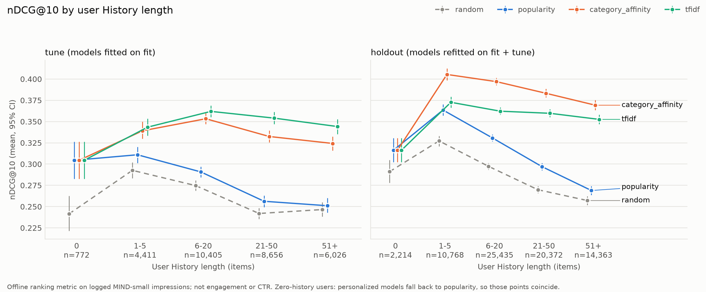

# Baseline results

> Generated by `scripts/evaluate.py`; do not edit by hand. Offline ranking metrics on logged impressions only, **not** engagement, CTR or business impact.

- Data provenance: `real_licensed`
- Generated: 2026-11-03T20:41:55+00:00 at git `1ebfcd0`
- Manifest: `v1`
- Reproduce: `uv run python scripts/evaluate.py --config configs/baseline.yaml`
- Seed 13; 1000 user-grouped bootstrap samples; 95% percentile intervals; fit/tune cutoff 2019-11-14T00:00:00.

## Interpretation

> Hand-written (`reports/interpretation.md`) and included verbatim. It holds no numbers by rule; they're in the tables below.

*Draft by the coding agent for owner review. Written against the manifest `v1` results;
re-read it whenever the tables change.*

### Strongest simple baseline

On holdout, `category_affinity` is the strongest simple ranker. It beats `popularity`
and `tfidf` overall, in every bucket of users with History, and on both sports slices,
and the paired intervals against both exclude zero. `tfidf` is second and also
clearly beats `popularity`. `random` sits below everything, as a sanity floor should.

**Caveat: the tune split disagrees.** On tune, `tfidf` led `category_affinity`
overall and in every bucket of users with History, though in the shortest-History
bucket that lead's interval includes zero. Had we picked a model on tune, we would have
picked `tfidf`. Two things differ between the splits: the day, and the statistics
source (fit only for tune, fit + tune for holdout). Until a tune-only diagnostic
explains the flip, the order of the two content rankers should be treated as
unstable from day to day. Their lead over `popularity` holds on both splits.

### What I'd ship first, and why

Ship `category_affinity` with the explicit `popularity` fallback:
- **Quality:** it is the best-scoring model on holdout.
- **Cost:** it is the cheapest personalized model. It counts categories in the
  user's History, needs no text model or vocabulary, and scores faster than `tfidf`
  at both the median and the tail.
- **Explainability:** every recommendation has a one-line reason ("because you read
  sports / NFL"), which suits a reason-code demo.
- **Cold start is explicit.** Users with no History get the popularity order, and
  the fallback rate is measured.

Treat it as the control for the next ladder step (item-item CF and a hybrid), not as
a final answer. Given the tune/holdout flip, a hybrid that uses both category and
text signals is the natural next candidate.

### Patterns worth knowing

- **Personalization pays more as History grows.** The gap between the personalized
  rankers and `popularity` widens from short to long histories.
- **Compare models within a bucket, not across buckets.** `random` also scores
  lower for long-History users, so their impressions are harder to rank. A falling
  line doesn't mean a model got worse for heavy readers.
- **Zero-History users get nothing beyond popularity here.** That's by construction
  (fallback). Offline, popularity itself is weak, because dev's fresh items have no
  train clicks and dev clicks are never features. A production feed would use
  minutes-old popularity, which this protocol deliberately can't simulate.
- **Coverage:** the personalized rankers put far more distinct items into a top ten
  than `popularity`, which concentrates on a few already-clicked items.
- **The sports slices don't say much yet.** Nearly every impression has at least one
  sports candidate, so that slice is close to the whole split. The "sports History"
  slice shows the same model order as the overall table. Nothing here is evidence of
  sports-specific behavior.

### What offline evaluation can't predict

- **Exposure bias:** labels come from what Microsoft News's 2019 system chose to
  show, so a ranker that would surface different items is judged only on items that
  policy already picked.
- **Position and presentation effects:** layout, images, reason codes and novelty
  wear-off are invisible in logged candidate lists.
- **Long-run effects:** feed diversity, filter bubbles, return visits and retention
  aren't measured by a per-impression ranking metric.
- **Freshness:** a live system's popularity signal is minutes old, not a day old.

None of these numbers are CTR or engagement. Deciding whether `category_affinity`
helps real users needs an online experiment: user-level randomization, a primary
metric chosen in advance, guardrails, and exposure logging.

## Figures

## Methods

- `random`: seeded random scores. Sanity floor.
- `popularity`: as-of click count of the item in the statistics source, ties broken by as-of clicks on the item's category. Non-personalized.
- `category_affinity`: (# History items in the candidate's category + # in its subcategory), ties broken by the popularity order. Users with no known History item fall back to `popularity`.
- `tfidf`: cosine between the candidate's title+abstract TF-IDF vector and the mean History vector; vocabulary and IDF fitted on items referenced by the statistics source. Ties broken by the popularity order; users with no usable History fall back to `popularity`.

MRR is MIND-style: the mean of 1/rank over all clicked candidates (D-009). Each metric is averaged per impression over the impressions eligible for it (D-010). Deltas are paired differences on the same impressions, with intervals from the same user resamples.

## Split: `tune`

- 30,270 impressions from 20,179 users; 0 no-click (excluded), 0 all-click (excluded from AUC).
- Models fitted on `fit` (126,695 impressions); 29.2% of candidate occurrences were never shown there.

| Model | NDCG@10 [95% CI] | Δ vs `popularity` [95% CI] | Δ vs `category_affinity` [95% CI] | AUC | MRR (MIND-style) | NDCG@5 | Fallback | Tied | Coverage@10 | p50 / p95 ms |
|---|---|---|---|---|---|---|---|---|---|---|
| `random` | 0.2615 [0.2582, 0.2649] | -0.0148 [-0.0182, -0.0114] | -0.0768 [-0.0808, -0.0728] | 0.5009 | 0.2023 | 0.2026 | 0 | 0 | 0.590 | 0.017 / 0.070 |
| `popularity` | 0.2763 [0.2729, 0.2798] | — | -0.0620 [-0.0654, -0.0587] | 0.5151 | 0.2136 | 0.2164 | 0 | 27,055 | 0.318 | 0.032 / 0.099 |
| `category_affinity` | 0.3383 [0.3344, 0.3421] | +0.0620 [+0.0587, +0.0654] | — | 0.5930 | 0.2626 | 0.2786 | 772 | 25,532 | 0.566 | 0.051 / 0.145 |
| `tfidf` | 0.3520 [0.3480, 0.3559] | +0.0757 [+0.0722, +0.0794] | +0.0137 [+0.0104, +0.0172] | 0.5936 | 0.2791 | 0.2956 | 772 | 11,226 | 0.599 | 0.183 / 0.312 |

Eligible impressions for NDCG@10: 30,270.

### NDCG@10 by user history length

| History length | Impressions | Users | `random` | `popularity` | `category_affinity` | `tfidf` |
|---|---|---|---|---|---|---|
| 0 | 772 | 476 | 0.2415 [0.2215, 0.2627] | 0.3045 [0.2826, 0.3264] | 0.3045 [0.2826, 0.3264] | 0.3045 [0.2826, 0.3264] |
| 1-5 | 4,411 | 3,634 | 0.2926 [0.2833, 0.3021] | 0.3110 [0.3012, 0.3201] | 0.3392 [0.3297, 0.3497] | 0.3434 [0.3334, 0.3534] |
| 6-20 | 10,405 | 8,108 | 0.2747 [0.2686, 0.2810] | 0.2908 [0.2846, 0.2970] | 0.3533 [0.3468, 0.3599] | 0.3620 [0.3552, 0.3690] |
| 21-50 | 8,656 | 5,333 | 0.2419 [0.2356, 0.2485] | 0.2563 [0.2495, 0.2630] | 0.3324 [0.3255, 0.3396] | 0.3540 [0.3469, 0.3615] |
| 51+ | 6,026 | 2,628 | 0.2465 [0.2384, 0.2551] | 0.2510 [0.2431, 0.2600] | 0.3243 [0.3161, 0.3325] | 0.3441 [0.3350, 0.3528] |

Paired Δ NDCG@10 vs `popularity` [95% CI]:

| History length | Impressions | Users | `random` | `popularity` | `category_affinity` | `tfidf` |
|---|---|---|---|---|---|---|
| 0 | 772 | 476 | -0.0630 [-0.0844, -0.0433] | (baseline) | fallback: = `popularity` | fallback: = `popularity` |
| 1-5 | 4,411 | 3,634 | -0.0183 [-0.0273, -0.0093] | (baseline) | +0.0282 [+0.0201, +0.0367] | +0.0325 [+0.0234, +0.0424] |
| 6-20 | 10,405 | 8,108 | -0.0161 [-0.0225, -0.0101] | (baseline) | +0.0625 [+0.0562, +0.0683] | +0.0712 [+0.0643, +0.0779] |
| 21-50 | 8,656 | 5,333 | -0.0144 [-0.0213, -0.0079] | (baseline) | +0.0762 [+0.0698, +0.0825] | +0.0978 [+0.0907, +0.1050] |
| 51+ | 6,026 | 2,628 | -0.0045 [-0.0119, +0.0034] | (baseline) | +0.0732 [+0.0649, +0.0804] | +0.0931 [+0.0844, +0.1020] |

### NDCG@10 on `sports` slices

Slices of general-news data, not a sports dataset. They overlap each other and the history buckets.

| Slice | Impressions | Users | `random` | `popularity` | `category_affinity` | `tfidf` |
|---|---|---|---|---|---|---|
| impressions with at least one `sports` candidate | 22,509 | 16,144 | 0.1825 [0.1789, 0.1859] | 0.1980 [0.1944, 0.2017] | 0.2706 [0.2667, 0.2747] | 0.2814 [0.2774, 0.2856] |
| impressions whose user History has at least one `sports` item | 19,916 | 12,534 | 0.2612 [0.2568, 0.2654] | 0.2712 [0.2666, 0.2756] | 0.3387 [0.3340, 0.3434] | 0.3521 [0.3473, 0.3566] |

Paired Δ NDCG@10 vs `popularity` [95% CI]:

| Slice | Impressions | Users | `random` | `popularity` | `category_affinity` | `tfidf` |
|---|---|---|---|---|---|---|
| impressions with at least one `sports` candidate | 22,509 | 16,144 | -0.0155 [-0.0194, -0.0116] | (baseline) | +0.0726 [+0.0688, +0.0766] | +0.0834 [+0.0793, +0.0878] |
| impressions whose user History has at least one `sports` item | 19,916 | 12,534 | -0.0100 [-0.0144, -0.0058] | (baseline) | +0.0674 [+0.0631, +0.0720] | +0.0809 [+0.0763, +0.0854] |

### Observations (computed from the tables above)

- Highest NDCG@10: `tfidf` (0.3520).
- `tfidf` vs `popularity`: Δ +0.0757 [+0.0722, +0.0794]; the interval excludes 0.
- `category_affinity` vs `popularity`: Δ +0.0620 [+0.0587, +0.0654]; the interval excludes 0.
- `random` vs `popularity`: Δ -0.0148 [-0.0182, -0.0114]; the interval excludes 0.
- `tfidf` vs `category_affinity`: Δ +0.0137 [+0.0104, +0.0172]; the interval excludes 0.
- `popularity` vs `category_affinity`: Δ -0.0620 [-0.0654, -0.0587]; the interval excludes 0.
- `random` vs `category_affinity`: Δ -0.0768 [-0.0808, -0.0728]; the interval excludes 0.
- Zero-history users (772 impressions): `category_affinity`, `tfidf` fall back to `popularity` on every impression, so they equal it there by construction.

## Split: `holdout`

- 73,152 impressions from 50,000 users; 0 no-click (excluded), 0 all-click (excluded from AUC).
- Models fitted on `fit+tune` (156,965 impressions); 21.3% of candidate occurrences were never shown there.

| Model | NDCG@10 [95% CI] | Δ vs `popularity` [95% CI] | Δ vs `category_affinity` [95% CI] | AUC | MRR (MIND-style) | NDCG@5 | Fallback | Tied | Coverage@10 | p50 / p95 ms |
|---|---|---|---|---|---|---|---|---|---|---|
| `random` | 0.2860 [0.2836, 0.2884] | -0.0276 [-0.0298, -0.0253] | -0.1005 [-0.1029, -0.0981] | 0.4997 | 0.2188 | 0.2224 | 0 | 0 | 0.659 | 0.013 / 0.063 |
| `popularity` | 0.3136 [0.3109, 0.3162] | — | -0.0729 [-0.0752, -0.0705] | 0.5462 | 0.2426 | 0.2534 | 0 | 58,701 | 0.354 | 0.028 / 0.098 |
| `category_affinity` | 0.3865 [0.3840, 0.3889] | +0.0729 [+0.0705, +0.0752] | — | 0.6223 | 0.3000 | 0.3277 | 2,214 | 55,097 | 0.632 | 0.045 / 0.138 |
| `tfidf` | 0.3598 [0.3573, 0.3623] | +0.0461 [+0.0437, +0.0486] | -0.0267 [-0.0291, -0.0245] | 0.5835 | 0.2790 | 0.2985 | 2,214 | 24,476 | 0.665 | 0.177 / 0.296 |

Eligible impressions for NDCG@10: 73,152.

### NDCG@10 by user history length

| History length | Impressions | Users | `random` | `popularity` | `category_affinity` | `tfidf` |
|---|---|---|---|---|---|---|
| 0 | 2,214 | 1,407 | 0.2911 [0.2780, 0.3049] | 0.3163 [0.3023, 0.3306] | 0.3163 [0.3023, 0.3306] | 0.3163 [0.3023, 0.3306] |
| 1-5 | 10,768 | 8,875 | 0.3272 [0.3211, 0.3332] | 0.3636 [0.3570, 0.3701] | 0.4054 [0.3985, 0.4124] | 0.3726 [0.3663, 0.3790] |
| 6-20 | 25,435 | 19,901 | 0.2974 [0.2935, 0.3011] | 0.3307 [0.3265, 0.3347] | 0.3969 [0.3926, 0.4014] | 0.3622 [0.3579, 0.3666] |
| 21-50 | 20,372 | 13,095 | 0.2698 [0.2659, 0.2740] | 0.2970 [0.2926, 0.3014] | 0.3833 [0.3786, 0.3885] | 0.3597 [0.3551, 0.3647] |
| 51+ | 14,363 | 6,722 | 0.2571 [0.2521, 0.2621] | 0.2689 [0.2638, 0.2741] | 0.3692 [0.3633, 0.3751] | 0.3525 [0.3471, 0.3579] |

Paired Δ NDCG@10 vs `popularity` [95% CI]:

| History length | Impressions | Users | `random` | `popularity` | `category_affinity` | `tfidf` |
|---|---|---|---|---|---|---|
| 0 | 2,214 | 1,407 | -0.0252 [-0.0369, -0.0127] | (baseline) | fallback: = `popularity` | fallback: = `popularity` |
| 1-5 | 10,768 | 8,875 | -0.0363 [-0.0421, -0.0302] | (baseline) | +0.0418 [+0.0361, +0.0474] | +0.0091 [+0.0031, +0.0150] |
| 6-20 | 25,435 | 19,901 | -0.0334 [-0.0371, -0.0293] | (baseline) | +0.0662 [+0.0624, +0.0702] | +0.0314 [+0.0272, +0.0356] |
| 21-50 | 20,372 | 13,095 | -0.0272 [-0.0313, -0.0230] | (baseline) | +0.0862 [+0.0819, +0.0910] | +0.0627 [+0.0581, +0.0676] |
| 51+ | 14,363 | 6,722 | -0.0118 [-0.0164, -0.0071] | (baseline) | +0.1003 [+0.0953, +0.1053] | +0.0836 [+0.0783, +0.0890] |

### NDCG@10 on `sports` slices

Slices of general-news data, not a sports dataset. They overlap each other and the history buckets.

| Slice | Impressions | Users | `random` | `popularity` | `category_affinity` | `tfidf` |
|---|---|---|---|---|---|---|
| impressions with at least one `sports` candidate | 67,124 | 46,640 | 0.2504 [0.2481, 0.2527] | 0.2801 [0.2778, 0.2823] | 0.3570 [0.3543, 0.3595] | 0.3269 [0.3243, 0.3293] |
| impressions whose user History has at least one `sports` item | 48,936 | 31,733 | 0.2863 [0.2834, 0.2891] | 0.3071 [0.3043, 0.3100] | 0.3960 [0.3930, 0.3990] | 0.3616 [0.3586, 0.3646] |

Paired Δ NDCG@10 vs `popularity` [95% CI]:

| Slice | Impressions | Users | `random` | `popularity` | `category_affinity` | `tfidf` |
|---|---|---|---|---|---|---|
| impressions with at least one `sports` candidate | 67,124 | 46,640 | -0.0297 [-0.0321, -0.0276] | (baseline) | +0.0768 [+0.0744, +0.0793] | +0.0467 [+0.0445, +0.0493] |
| impressions whose user History has at least one `sports` item | 48,936 | 31,733 | -0.0208 [-0.0234, -0.0182] | (baseline) | +0.0889 [+0.0862, +0.0918] | +0.0545 [+0.0513, +0.0575] |

### Observations (computed from the tables above)

- Highest NDCG@10: `category_affinity` (0.3865).
- `category_affinity` vs `popularity`: Δ +0.0729 [+0.0705, +0.0752]; the interval excludes 0.
- `tfidf` vs `popularity`: Δ +0.0461 [+0.0437, +0.0486]; the interval excludes 0.
- `random` vs `popularity`: Δ -0.0276 [-0.0298, -0.0253]; the interval excludes 0.
- `tfidf` vs `category_affinity`: Δ -0.0267 [-0.0291, -0.0245]; the interval excludes 0.
- `popularity` vs `category_affinity`: Δ -0.0729 [-0.0752, -0.0705]; the interval excludes 0.
- `random` vs `category_affinity`: Δ -0.1005 [-0.1029, -0.0981]; the interval excludes 0.
- Zero-history users (2,214 impressions): `category_affinity`, `tfidf` fall back to `popularity` on every impression, so they equal it there by construction.

## Limitations

- Offline ranking metrics on logged MIND-small impressions only; they are not engagement, CTR or business-impact estimates.
- Labels come from impressions served by Microsoft News's own 2019 system, so they reflect that system's exposure; offline metrics can't predict online behavior.
- General news from November 2019; results don't show sports-specific behavior.
- MIND-small numbers aren't comparable to the public MIND leaderboard (scored on MIND-large test).
- Holdout statistics come from fit + tune (train) only; dev clicks are never features, so popularity is up to a day stale and items first shown in dev have no click history.
- Ties are broken by one seeded draw (D-008); MRR and nDCG of tie-heavy models can move with the seed. AUC counts ties as 0.5.
- Bootstrap intervals resample users and treat the logged candidate sets as fixed.
